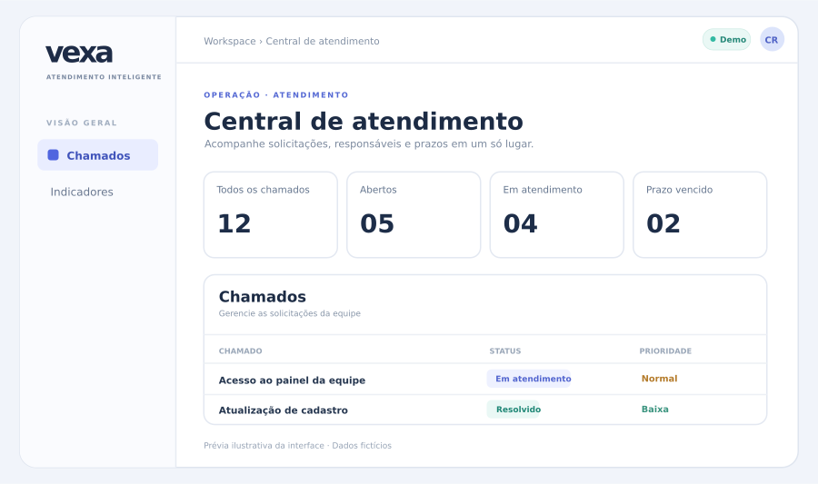

# Vexa — demonstração navegável

Central de atendimento com perfis fictícios de cliente, agente e gestora. Acesse a aplicação, troque o perfil, abra um chamado como cliente, assuma e resolva como agente, e reabra como cliente. Chamados e histórico são persistidos em D1.

## Demonstração ao vivo

### [▶ Abrir a Vexa no navegador](https://vexa-sabrina.limaucello.chatgpt.site)

O GitHub mostra o código e este README; a aplicação interativa abre pelo link acima. Não é necessário criar uma conta.

Para conhecer o fluxo: selecione **Marina · Cliente** e abra um chamado; troque para **Rafael · Agente** para assumir e resolver; volte à cliente para reabrir. Em **Camila · Gestora**, abra **Indicadores** para ver prazos e carga de atendimento.

Esta é uma demonstração pública com dados fictícios compartilhados entre visitantes. Não insira informações pessoais ou reais.

## Escopo implementado

- Painel com métricas de status e prazos; busca e filtro.
- Área da gestora com cumprimento de SLA, tempo médio de resolução, prioridades, carga por responsável e fila ordenada pelo prazo.
- Abertura de chamado, atribuição, resolução, reabertura e comentários.
- Validação no servidor, transições de estado e prevenção de atualizações concorrentes por versão.
- Histórico de mudança de estado criado por triggers no banco.
- Dados fictícios pré-carregados apenas quando o banco está vazio.

**Importante:** o seletor de perfis é uma simulação para apresentação. Esta versão não implementa contas reais, convite de membros, isolamento multiempresa ou autorização baseada em identidade do usuário. Não a apresente como um produto pronto para empresas.

Este site usa React/TypeScript e armazenamento D1 no ambiente Sites. O projeto planejado para o portfólio técnico prevê Angular, Java/Spring Boot e PostgreSQL; a base Java das regras está no marco 1 e ainda não está conectada a esta demonstração.

## Desenvolvimento

As dependências e o processo de publicação são gerenciados pelo projeto Sites. A migração inicial está em `drizzle/0000_handy_lake.sql`. Os dados de demonstração são inseridos em `lib/atlas.ts` na primeira consulta a um banco vazio.
